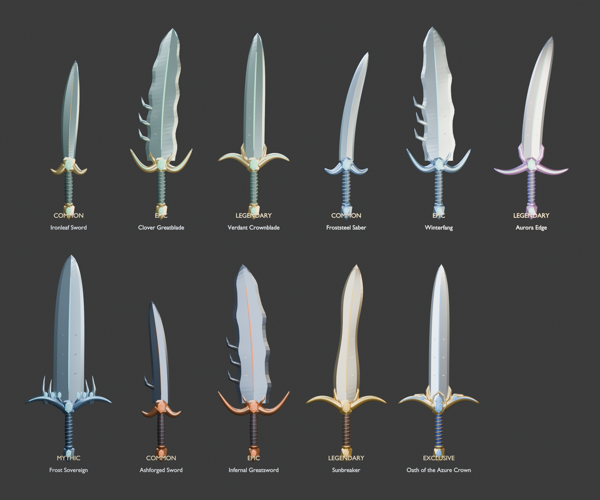

# Original sword collection

The existing UI and weapon economy are unchanged. Ten original meshes map to the
existing Sword/Greatsword IDs; a separate royal exclusive is reserved outside the
loot catalog. Bows, spears, and gauntlets keep their identities and drop tables.
The reference informed blue/gold royal styling, not copied geometry or character art.

| Tier | Models |
| --- | --- |
| Common | Ironleaf Sword, Froststeel Saber, Ashforged Sword |
| Epic | Clover Greatblade, Winterfang, Infernal Greatsword |
| Legendary | Verdant Crownblade, Aurora Edge, Sunbreaker |
| Mythic | Frost Sovereign |
| Exclusive, reserved | Oath of the Azure Crown |

Each sword has a curved or tapered blade, a raised ridge, swept guard, faceted
gemstone sockets, real helical grip binding, and a detailed pommel. Higher tiers
add hooks, prongs, relief motifs, and colored inlays. Frost Sovereign adds a crown
of ice spines; Azure Crown adds sapphire wing crests and original royal heraldry.
These are authored polygon meshes, not collections of Roblox block primitives.
Each sword uses four material groups and 5,206–6,230 triangles.

## Files and rebuilding

- `assets/swords/SwordCollection.blend`: editable collections and gallery setup.
- `assets/swords/<weapon-id>.glb`: individual mesh exports, grip origin at zero.
- `assets/swords/<weapon-id>.mesh.json`: vertices, triangles, baked corner normals.
- `src/assets/SwordGeometry.rbxmx`: server-only geometry modules included by Rojo.
- `tools/build_swords.py`: reproducible Blender authoring/export/render script.
- `tools/package_sword_geometry.py`: geometric validation and Rojo packaging.

Run Blender in background with `--python tools/build_swords.py`, then
`python3 tools/package_sword_geometry.py` and `rojo build -o ChestRPG.rbxlx`.
The package command also prepares a Studio source-install request at
`/tmp/chest_verify_sync.json`; it does not itself contact Studio.

## Runtime and security

`SwordMeshFactory` builds 44 MeshParts once per server before spawning players.
It uses [Roblox DataModel-scoped mesh content](https://create.roblox.com/docs/reference/engine/classes/AssetService#CreateDataModelContentAsync).
Opaque content is ephemeral; the saved geometry source recreates it for each new
server. Never export the generated bank as a substitute for the source modules.
Edit-generated mesh content is removed before rebuilding in Play mode.

Enable **Experience Settings → Security → Allow Mesh & Image APIs** before Play
testing or publishing this runtime mesh approach. See [EditableMesh requirements](https://create.roblox.com/docs/reference/engine/classes/EditableMesh).
If mesh creation fails, the game continues without sword visuals and prints an
explicit warning; stale content is removed rather than attached invisibly.

`WeaponVisualService` reads the active server profile, checks known weapon ID,
valid ownership, sword family, and complete model availability. It attaches one
massless, non-colliding model to the R15 right hand or R6 right arm. Switching,
ownership revocation, profile readiness loss, and respawning refresh the model.
No remote accepts geometry, model instances, asset IDs, cosmetic grants, or damage.
The exclusive has no ordinary equip/drop entry until its acquisition is designed.
Weapon animations, attack hitboxes, damage, and armor are separate future work.

## Verification on 2026-09-30

- All eleven geometry payloads: finite coordinates and unit normals, valid indices,
  no degenerate triangles, four material groups each. Evidence:
  `swords/geometry-validation.json`.
- Blender gallery rendered and visually inspected; individual GLBs exported.
- Studio Edit mode built eleven models / 44 MeshParts / 63,350 triangles in ~1.91s.
  The actual Studio gallery was captured and visually inspected.
- First Play run: 14 of 15 integration checks passed, including switching all ten
  owned catalog swords, ownership rejection, exclusive rejection, clearing a sword
  for bow equipment, collision/weld flags, and character respawn.
- The remaining mesh-content check caught the disabled Mesh & Image API setting.
  Server creation was blocked and Edit-scoped content did not survive into Play.
  This is **not a successful client-render verification**. The stale-content
  fallback and ownership-revocation refresh were subsequently added.
- Existing headless progression/security suite: 63 passed, 0 failed.
- After the fallback fix, a fresh Play session confirmed profile readiness, enabled
  `ChestRPGUI`, a living avatar, no stale preview gallery, and no unavailable sword
  bank or invisible attachment. Evidence: `swords/studio-fallback-verification.json`.
- Full Play mode rendering, the added revocation check, grip appearance on the
  player's avatar, multiplayer replication, and a published server require the
  mesh permission setting to be enabled before final verification.

The GLBs can also be imported through [Studio's standard 3D Importer](https://create.roblox.com/docs/art/accessories/creating-rigid/importing)
if permanent uploaded MeshPart assets are preferred later. The direct asset-upload
API was unavailable in this Studio build; no uploads or live publication were made.
